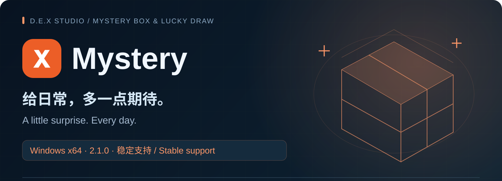
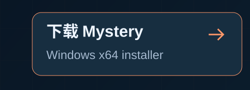
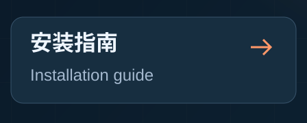
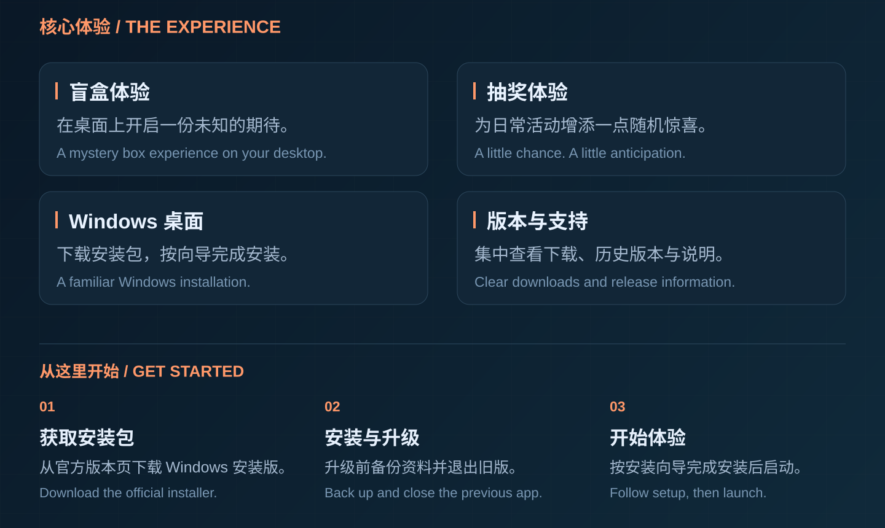

展开使用说明与链接 / Read details & links

文字版介绍与常用链接 / Accessible overview & links

Windows x64 · 2.1.0 · 稳定支持 / Stable support

- **盲盒体验**：在桌面上开启一份未知的期待。 A mystery box experience on your desktop.
- **抽奖体验**：为日常活动增添一点随机惊喜。 A little chance. A little anticipation.
- **Windows 桌面**：下载安装包，按向导完成安装。 A familiar Windows installation.
- **版本与支持**：集中查看下载、历史版本与说明。 Clear downloads and release information.

- [下载 Mystery / Windows x64 installer](https://github.com/dex-ovo-studio/Mystery/releases/download/mystery-v2.1.0/DEX-Setup-2.1.0-x64.exe)
- [安装指南 / Installation guide](https://github.com/dex-ovo-studio/Mystery/blob/main/docs/guide.md)
- [版本与支持 / Releases & support](https://github.com/dex-ovo-studio/Mystery/blob/main/STATUS.md)

[官方网站 / Website](https://mystery.mydex.top) · [历史版本 / Release history](https://github.com/dex-ovo-studio/Mystery/releases) · [旧版兼容归档 / Legacy archive](https://github.com/dex-ovo-studio/DEX-Studio-Software-Status#mystery-history)

