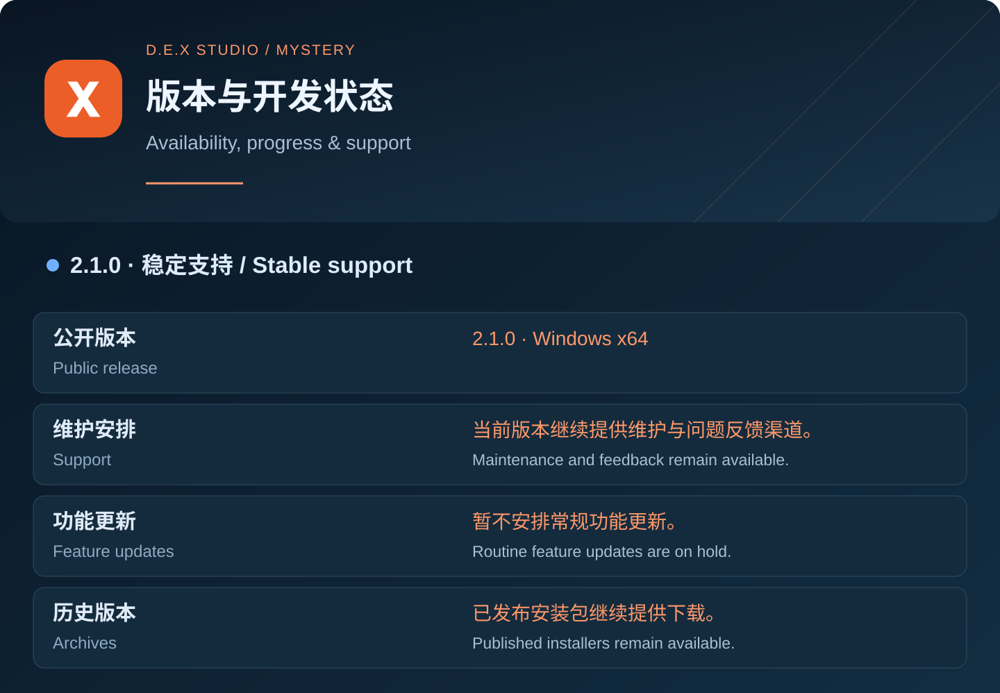

文字版状态 / Accessible status

[← Mystery](https://github.com/dex-ovo-studio/Mystery) · [所有软件 / All software](https://github.com/dex-ovo-studio/DEX-Studio-Software-Status)

**🔵 稳定支持 / Stable support**  
2.1.0 · Windows x64

| 内容 / Area | 状态 / Status |
| :--- | :--- |
| 公开版本 / Public release | 2.1.0 · Windows x64 |
| 维护安排 / Support | 当前版本继续提供维护与问题反馈渠道。 / Maintenance and feedback remain available. |
| 功能更新 / Feature updates | 暂不安排常规功能更新。 / Routine feature updates are on hold. |
| 历史版本 / Archives | 已发布安装包继续提供下载。 / Published installers remain available. |

[下载 2.1.0 / Download](https://github.com/dex-ovo-studio/DEX-Studio-Software-Status/releases/tag/mystery-v2.1.0) · [安装指南 / Guide](https://github.com/dex-ovo-studio/Mystery/blob/main/docs/guide.md) · [历史版本 / History](https://github.com/dex-ovo-studio/DEX-Studio-Software-Status#mystery-history)

